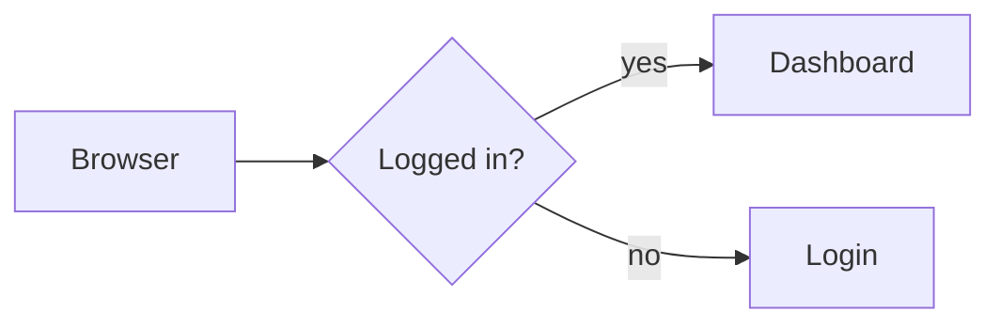

# d2 blocks

Build diagrams by stacking blocks. Get clean [d2](https://d2lang.com) source you
can put in a pull request.

**→ [kalter666.github.io/d2-blocks](https://kalter666.github.io/d2-blocks/)**


Runs entirely in the browser — no server, no accounts. Deploys to GitHub Pages
as a static site.

## Why

d2 is a good language and a rough first experience for someone non-technical:
blank page, unfamiliar syntax, and a typo in `a -> b` silently *creates* a
phantom box instead of erroring. Visual tools avoid that but hand you a binary
blob nobody can review in a diff.

This tries to be both. You assemble a stack of blocks — *box*, *group*,
*connect*, *style* — and the d2 source is generated from it. Nobody has to type
syntax, and what comes out is the same file a developer would have written by
hand. The source pane is editable too, so anyone who *does* know d2 can type or
paste straight into it and watch the blocks rearrange themselves.

```
┌────────────────────────┐
│ ▤ group [Backend]      │      Backend: {
│   ┌──────────────────┐ │        API
│   │ ■ box [API]      │ │        Worker
│   │ ■ box [Worker]   │ │      }
│   └──────────────────┘ │      Backend.API -> Database
├────────────────────────┤
│ → [API ▾] to [DB ▾]    │
└────────────────────────┘
```

Two things fall out of blocks mapping 1:1 onto d2 statements:

- **Connections pick from a dropdown, never free text.** You can only connect
  boxes that exist, so phantom boxes are impossible.
- **Round-trips are lossless.** Any statement with no matching block becomes a
  grey `d2` block holding the line verbatim. Paste in a hand-written file using
  vars, classes or imports, edit something unrelated, and the parts this editor
  doesn't understand come back byte-for-byte.

## Features

Each one has a short demo in **[docs/FEATURES.md](docs/FEATURES.md)**:

- [Build with blocks](docs/FEATURES.md#build-with-blocks) — assemble a diagram without typing syntax
- [Edit or paste d2](docs/FEATURES.md#edit-or-paste-d2) — the source pane is live; pasted files round-trip byte-for-byte
- [Connections that can't invent boxes](docs/FEATURES.md#connections-that-cant-invent-boxes) — both ends are dropdowns
- [Shapes are roles](docs/FEATURES.md#shapes-are-roles) — *Database*, *Queue*, *User* instead of d2 names
- [Groups and nesting](docs/FEATURES.md#groups-and-nesting) — drag blocks into containers
- [Styles](docs/FEATURES.md#styles) — one property per block, only values d2 accepts
- [Rich text labels](docs/FEATURES.md#rich-text-labels) — markdown with a small editor
- [Undo and redo](docs/FEATURES.md#undo-and-redo)
- [3D look](docs/FEATURES.md#3d-look) — real solids with an orbit camera
- [Hover links both sides](docs/FEATURES.md#hover-links-both-sides) — block ⟷ object highlighting
- [Layout, direction and sketch](docs/FEATURES.md#layout-direction-and-sketch) — dagre or ELK, any direction
- [Themes and appearance](docs/FEATURES.md#themes-and-appearance) — every d2 palette, light and dark
- [Tables, classes, code, icons and tooltips](docs/FEATURES.md#tables-classes-code-icons-and-tooltips) — in 3D too
- [Sequence diagrams](docs/FEATURES.md#sequence-diagrams)
- [Layers, scenarios and steps](docs/FEATURES.md#layers-scenarios-and-steps) — a board picker for multi-board files
- [Examples gallery](docs/FEATURES.md#examples-gallery) — thirty-odd architectures with live previews
- [Mermaid import](docs/FEATURES.md#mermaid-import) — and Copy Mermaid back out
- [Export](docs/FEATURES.md#export) — Copy d2, Copy Mermaid, Download SVG
- [Language](docs/FEATURES.md#language) — English and Russian

## Shapes are roles

The shape dropdown lists what people actually draw — *Database*, *Queue*, *User*,
*Cloud / external* — not `cylinder`, `queue`, `person`, `cloud`. The value written
to the source is still d2's own name, so nothing about the file changes; hover an
option to see which one it is. All 18 of d2's shapes are there, so a pasted file
using `stored_data` still shows the right thing selected.

## Two looks

**3D** is the default. The diagram lies on a grid floor and every shape becomes
a small physical object — a database is rack hardware with populated drive bays,
a service is a vented appliance, storage is an industrial tank with a valve, and
the name sits on a plaque where the object cannot hide it. Connections glow and
their ticks march. **flat** is the ordinary d2 render.

`src/Scene.svelte` is a [three.js](https://threejs.org) renderer. d2 still compiles
and lays the diagram out; the scene reads the geometry out of the compiled result
and builds real solids, lit and casting shadows, with an orbit camera. Models use
separate physical materials for glass, paper, cardboard, skin, rubber and metal
instead of tinting every part like painted steel. Labels are sprites, so they face
the camera from any angle instead of lying on the ground.

The SVG stays mounted but hidden. Download SVG still works from it, and each
object’s resolved theme and style are read from the shape d2 drew, so the light
and dark theme selectors work in both views without duplicating d2's palettes.
Appearance can follow the system or be forced light/dark; choosing a palette
automatically previews its matching appearance.
Tables, UML classes, code and LaTeX become slabs carrying d2's own drawing of
them; icons and `shape: image` stand as pictures; sequence diagrams keep their
lifelines; every d2 arrowhead (crow's feet included), arrowhead labels, dashes,
tooltips and links carry over. Files with `layers`, `scenarios` or `steps` get a
**board** picker in the toolbar, for both looks.
Styles — from style blocks, classes, vars or globs alike — translate into 3D material colour, opacity, surface relief, shadows,
label typography and animation. The marching connections and styled object
animation stop under `prefers-reduced-motion: reduce`.

## Examples

**▦ Examples** opens a gallery of ready-made architectures — three-tier web app,
event-driven, saga, RAG, zero-trust, and thirty-odd more — filtered by category or
by a search over titles, descriptions and tags. Each one renders a live preview
with the real compiler before you commit to it; loading one replaces the source and
is a single undo away.

Every example is an ordinary `.d2` file in `src/examples/`, with its metadata in
`catalog.js`. Vite inlines them at build time, so the gallery needs no fetches, and
`examples.test.js` compiles all of them and round-trips each through `parse`, so a
bundled example that stopped being editable as blocks fails CI.

## Rich text

d2 labels can be markdown, which is what turns a diagram into something readable
rather than a grid of captions. It isn't a separate kind of block — hit `¶` on
any box or connection and its label becomes a small WYSIWYG editor (headings,
bold, italic, code, links, lists) writing an ordinary block string. A box keeps
its shape, so a cylinder or an oval holds rich text just as well as a plain
rectangle. `⤢` pops the editor out into a full-size window when a few lines in a
narrow column isn't enough room:

```
Notes: |md
  # Payment flow
  - charges the card
|
```

Markdown is what's stored; the HTML only exists so a `contenteditable` can show
it. `rich()` in `src/md.js` is the safety catch: it hands a block to the visual
editor **only** if the markdown survives a round-trip byte-for-byte. Anything
else — a table, an image, raw HTML, a nested list — opens as a plain markdown
textarea with a button to reformat, so editing can never quietly rewrite text
the toolbar didn't understand.

## Use it from an AI agent (MCP)

The repo ships an [MCP](https://modelcontextprotocol.io) server, so an agent
(Claude Code, Claude Desktop, or any MCP client) can draw with the same d2
engine and editor logic this site runs — and hand you a link that opens the
result here as editable blocks.

Try a link it made: **[order flow](https://kalter666.github.io/d2-blocks/#d2=RcwxDsMgEETRnlPMBXIBikgpU9mND0BgZFayAO0SKVHku0fQuH4zP4kydqnFQ2XP3b2N6rEZFT9YDo0ejWq14HShicdjfV6U-Qn7tPTyWDRR7dL4PaQkKs7Zxe2OmWhHiDTUMR_RAeMvxajd_QE)**,
**[a login flowchart converted from mermaid](https://kalter666.github.io/d2-blocks/#d2=JcqxDQIxDEbh3lP8C7CAC9DlUt4SAVuJC-yTcxJCiN0RUL2veGKpt8PCGWl9HLQwSsZjalJhbNG7CswveM3RdmWItXu4vGll1DbHNVoK1d9rTgtOZxQq36yMp86_K8ODPg)**,
**[the three-tier example](https://kalter666.github.io/d2-blocks/#d2=VY9BbsMgEEX3nGIu0AuwqGTZi6YL12pSZRmNYWojOeDMTBZRxN0r7NZWV8D_A7znA5PTkKIFDsOo5kuIxcKywFNGnMnCTCwpZlM3rYW6abfCTenuszlTb-FMPXxzikrR7zdxoGyq7mChmucpOCyfQdUdtpECgHGYKJsa3UgWPskHAVcO25RoYvIXj4rZNKjYo5CFjsMV-QH-N9nJHlOInjivRvDyCgv92-nUHYtISRZuUdTgAEVIpaiUZiF-P360ZVf4lwdWvDEpMKGXv3zHud2JA8kq8r9ada5BxPwA)**.

### Set up

It runs locally, from a GitHub release: a single bundled file (~180 KB packed)
plus the d2 engine, fetched on first run. Node 20+ is all it needs; no clone,
no npm account.

- **Claude Code:**
  ```sh
  claude mcp add d2-blocks -- npx -y --package=https://github.com/Kalter666/d2-blocks/releases/latest/download/d2-blocks-mcp.tgz d2-blocks-mcp
  ```
- **Claude Desktop / other local MCP clients** — add to the client's config:
  ```json
  { "mcpServers": { "d2-blocks": { "command": "npx",
    "args": ["-y", "--package=https://github.com/Kalter666/d2-blocks/releases/latest/download/d2-blocks-mcp.tgz", "d2-blocks-mcp"] } } }
  ```

`latest` follows new releases; pin one by using
`releases/download/mcp-v1.1.0/d2-blocks-mcp.tgz` instead. Inside a clone of this
repo, Claude Code picks up the development copy from `.mcp.json` instead.

Web Claude and ChatGPT can only reach MCP servers hosted at a public URL, and
this one isn't hosted; the links it makes open in the hosted editor from
anywhere.

### How it works

```
agent ──MCP (stdio)──> mcp/server.js ──> the app's own modules, under node
                                          ├─ src/d2.js      d2 compile + render (wasm), one job at a time
                                          ├─ src/blocks.js  the editor's parser / printer
                                          ├─ src/mermaid.js mermaid ⇄ d2
                                          └─ src/share.js   #d2= links
open_in_editor ──> https://kalter666.github.io/d2-blocks/#d2=<deflated source>
                     └─ the site decodes it in the browser and loads it as blocks
```

Nothing is reimplemented for the server, so what it renders and checks is
exactly what the editor will do. The diagram in a link lives in the URL
*fragment*, which browsers never send to a server — GitHub Pages only ever
serves the static app. Opening a link replaces the current diagram; undo brings
yours back. Links decode to at most 512 KB of d2.

### Tools

| Tool | Input | Returns |
|---|---|---|
| `render_d2` | `source`, optional `theme`, `darkTheme`, `layout` (`dagre`/`elk`), `sketch`, `board`, `out` | the flat SVG — or, with `out: "x.svg"`, writes it there and returns path and size |
| `check_d2` | `source`, optional `look` (`flat`/`3d`) | compiles?, what the editor does to it (`exact` / `reformatted` / `changed`), what stays as raw d2, counts, the layout used; with `look: "3d"`, a 3D scene estimate and advice |
| `shapes` | — | every shape: its d2 name, the role it stands for, the model it becomes in 3D, its mesh count |
| `convert` | `from` (`mermaid` or `d2`), `source` | the other language (flowcharts; best-effort) |
| `examples` | optional `id` | the bundled gallery, or one example's d2 source |
| `open_in_editor` | `source`, optional `look`, `layout`, `base` | a link that opens the diagram in this editor, in that view and layout |

### Flat or 3D?

The server tells the agent to ask, because the answer changes what a good
diagram looks like. Flat is a classic SVG: any size d2 can lay out. In 3D every
shape becomes a physical model — a `cylinder` is a server cabinet with drive
bays, a `person` a figure, a `queue` a transport tube — so:

- **fewer, meaningful shapes.** An object is 3–53 meshes (a plain box 3, a
  database 53) where flat draws one SVG element; aim for about 40 objects and
  put detail in layers. `check_d2` with `look: "3d"` counts the draw calls and
  says when it gets heavy.
- **give every node a role.** Unshaped boxes all become the same generic block;
  `shapes` lists what each role turns into.
- **2–3 levels of nesting.** Containers are platforms; deeper nesting stacks
  them.

`render_d2` only draws flat (3D needs WebGL); for 3D the agent hands over
`open_in_editor` with `look: "3d"`.

### How big can a diagram be?

Measured with the real engine:

- **The link is never the limit.** It compresses to about a fifth of the
  source (1,000 shapes ≈ 14 KB) and decodes up to 512 KB of d2.
- **Layout is.** dagre, the default, crashes on some diagrams with links between
  groups (from ~100 shapes in testing); the tools then retry with elk and say
  so, and the editor suggests switching. elk lays out ~600 grouped shapes in
  ~8 s; the editor's hang detection allows more time the bigger the source.
- **An SVG reply is small.** d2 inlines its fonts, so 20 shapes are ~46 KB;
  above 80 KB `render_d2` asks for `out` and writes a file instead of flooding
  the agent's context.
- **3D reads best at ~40 objects**, as above.

### Examples

Ask for a diagram, get a link. The agent asks flat or 3D, writes d2, checks
it, and calls `open_in_editor`:

```d2
direction: right
user: User { shape: person }
api: API { shape: hexagon }
db: Orders { shape: cylinder }
user -> api: places order
api -> db: insert
```

`check_d2` on it:

```json
{ "compiles": true, "roundTrip": "reformatted", "rawBlocks": [],
  "shapes": 3, "connections": 2, "boards": [],
  "editorSource": "direction: right\nuser: User {shape: person}\n…" }
```

`reformatted` means the editor reprints `{ shape: person }` as
`{shape: person}` and the diagram is unchanged. With `look: "3d"` it adds
`"threeD": { "objects": 3, "containers": 0, "drawCalls": 99, "advice": [] }`.
`open_in_editor` then returns **[this link](https://kalter666.github.io/d2-blocks/#d2=RcwxDsMgEETRnlPMBXIBikgpU9mND0BgZFayAO0SKVHku0fQuH4zP4kydqnFQ2XP3b2N6rEZFT9YDo0ejWq14HShicdjfV6U-Qn7tPTyWDRR7dL4PaQkKs7Zxe2OmWhHiDTUMR_RAeMvxajd_QE)**.

Bring a mermaid flowchart over with `convert` (`from: "mermaid"`):



```d2
direction: right
A: Browser
B: Logged in? {shape: diamond}
C: Dashboard
D: Login
A -> B
B -> C: yes
B -> D: no
```

… and **[open it](https://kalter666.github.io/d2-blocks/#d2=JcqxDQIxDEbh3lP8C7CAC9DlUt4SAVuJC-yTcxJCiN0RUL2veGKpt8PCGWl9HLQwSsZjalJhbNG7CswveM3RdmWItXu4vGll1DbHNVoK1d9rTgtOZxQq36yMp86_K8ODPg)**.

Start from the gallery: `examples` lists ids such as `three-tier`,
`ecommerce` and `realtime-chat`; `examples { id: "three-tier" }` returns its
source, ready to edit or **[open](https://kalter666.github.io/d2-blocks/#d2=VY9BbsMgEEX3nGIu0AuwqGTZi6YL12pSZRmNYWojOeDMTBZRxN0r7NZWV8D_A7znA5PTkKIFDsOo5kuIxcKywFNGnMnCTCwpZlM3rYW6abfCTenuszlTb-FMPXxzikrR7zdxoGyq7mChmucpOCyfQdUdtpECgHGYKJsa3UgWPskHAVcO25RoYvIXj4rZNKjYo5CFjsMV-QH-N9nJHlOInjivRvDyCgv92-nUHYtISRZuUdTgAEVIpaiUZiF-P360ZVf4lwdWvDEpMKGXv3zHud2JA8kq8r9ada5BxPwA)**.

`render_d2` returns the flat SVG, for an agent that wants to save or embed it
(`sketch: true` for the hand-drawn look, `out: "diagram.svg"` for anything but a
small one). It's d2's output: a markdown label
can carry raw HTML, so treat the SVG as untrusted if its source was.

## Develop

```sh
npm install
npm run dev      # http://localhost:5173/d2-blocks/
npm test         # round-trip + real-compiler checks
npm run test:e2e # Playwright, incl. e2e/syntax.spec.js: every d2 construct
npm run build
```

The 3D bodies are geometry, so `models.test.js` measures them without a GPU: one
per d2 shape, checking it stands on the floor, fits the footprint d2 reserved, and
is the height it claims. That caught four real bugs the first time it ran. What it
*can't* judge is whether a thing looks like a database — open
`http://localhost:5173/d2-blocks/?gallery` for that. It puts one of every shape on
screen at once, and doesn't touch your saved diagram.

`npm test` is worth running before touching `blocks.js`. Beyond the tree
round-trip it compiles the generated d2 with the real d2 engine and asserts the
result *means* the right thing — that caught two bugs where the output parsed
fine but drew the wrong diagram.

## Deploy

Push to `main`. The workflow builds with `BASE_PATH=/<repo>/` and publishes to
Pages; enable Pages → Source → GitHub Actions once. For a custom domain at the
root, set `BASE_PATH=/`.

## How it works

```
block tree ──serialize()──> d2 ──compile()──> diagram ──render()──> SVG
     ▲                       │
     └────────parse()────────┘
```

Both directions are live. Block edits reserialise the source; typing or pasting
in the code pane reparses it into blocks. While the code pane has focus your text
wins, so you aren't reformatted mid-word; on blur the canonical serialisation
takes over, which doubles as format-on-blur.

`serialize` is total; `parse` is best-effort with a verbatim fallback, so the
pair round-trips even when parsing fails completely.

d2 runs in a web worker via [`@terrastruct/d2`](https://www.npmjs.com/package/@terrastruct/d2)
(stock, no fork). The canvas is the rendered SVG — hover linking works because
d2 tags every shape's `<g>` with `base64(id)`, so there is no second render
pipeline and no hit-testing geometry.

The module map, invariants and recipes for changing things live in
[`CLAUDE.md`](CLAUDE.md), which is written for whoever edits the code next,
person or agent.

## Known limits

- **No manual positioning.** d2 always auto-layouts — `top`/`left` exist only on
  the paid TALA engine — so you choose a direction and a layout engine, not
  coordinates. Every edit reflows the whole diagram.
- **Style values are constrained to what d2 accepts.** Each property carries its
  own editor and range (colour picker, bounded number, checkbox, enum), taken
  from d2's own validation rather than guessed. `npm test` compiles every
  default and both ends of every range, so a drifting bound fails CI.
- **Every family is modelled.** A database is a server cabinet, storage is a
  hooped tank with pipework, a queue is a flanged transport tube, a state is an
  illuminated indicator, start/end is a two-button control station, a decision
  is a warning sign on a post, a cloud is a shaded weather cloud, an actor is a
  clothed figure, input/output is an open workstation, a process step is a
  conveyor station, a document is a tabbed file folder, a page is a monitor, a
  callout is a pinned note, and a component is a populated circuit board. Only a
  container's platform is a plain extrusion. Skins are painted procedurally into
  canvases at startup — no image assets — and every model is built to the
  footprint d2 laid out, so the 3D view and the flat one agree about where
  things are.
- **3D shows one line of each label.** Labels are drawn into a canvas texture, so a
  markdown note appears in 3D as its first line — read it in flat mode or on the
  block.
- **Icons need CORS in 3D.** An icon becomes a WebGL texture, so its host must
  send `Access-Control-Allow-Origin`; one that doesn't is simply left out of the
  3D view (flat still shows it). icons.terrastruct.com's CDN sends it
  inconsistently.
- **three.js costs ~150 kB gzipped** on top of the d2 wasm. It is bundled, not
  lazy-loaded, so flat-mode-only users pay for it too.
- **Rich text is a box, not a group.** A markdown label on a group turns it into
  a text shape and orphans its children — verified against the compiler — so the
  `¶` toggle is only offered on boxes. All 18 shapes hold markdown fine; leaving
  the shape unset is the one case d2 renders borderless, which is why the
  dropdown calls that option *text* once rich text is on.
- **A duplicate name is flagged, not prevented.** d2 merges two boxes called
  `auth` in the same scope into one shape. A drag that would cause that is
  refused outright, but typing a clashing name only turns the field red — you
  can't refuse a keystroke without making `authx` untypeable.
- **Nesting is drag-only.** Arrow keys on a block's grip reorder it within its
  list; moving a block *into* a group needs a mouse.
- **A pasted diagram is untrusted markup.** d2 copies raw HTML out of a markdown
  label straight into a `<foreignObject>`, and the canvas mounts its SVG with
  `{@html}` — so `sanitize()` in `src/sanitize.js` strips event handlers, script
  and frame elements, and any URL scheme that isn't http(s), mailto, a fragment or
  a data image. Without it, `x: |md  |` in a file someone
  sent you would run on this origin. There is no Content-Security-Policy header:
  Pages serves static files only, and the d2 worker needs `wasm-unsafe-eval` and a
  blob worker, so a meta CSP tight enough to be worth having would break it.
- **The examples are inlined, not fetched.** Every bundled `.d2` file ships in the
  JavaScript bundle, which is why the gallery opens instantly and why adding a
  hundred more would need `import.meta.glob` without `eager`.
- **First load is heavy.** The d2 wasm is ~6 MB gzipped. If that becomes a
  problem, serve `d2.wasm` as a separate cacheable asset instead of using the
  npm browser bundle, which inlines it.
- `parse` is a line scanner, not a d2 parser. It's exact on files this editor
  wrote and non-destructive on files it didn't: d2 keyword maps (`vars`,
  `classes`, boards), `sql_table`/`class` bodies, globs and the like are kept as
  raw d2 blocks rather than becoming editable ones.

## Licence

[MIT](LICENSE).

The build inlines [d2](https://github.com/terrastruct/d2), which is
[MPL-2.0](https://github.com/terrastruct/d2/blob/master/LICENSE.txt). MPL is
file-level copyleft and explicitly allows distribution inside a larger work
under other terms, so this project stays MIT — but d2's own files remain MPL
wherever they end up, including in the bundle served from Pages.
